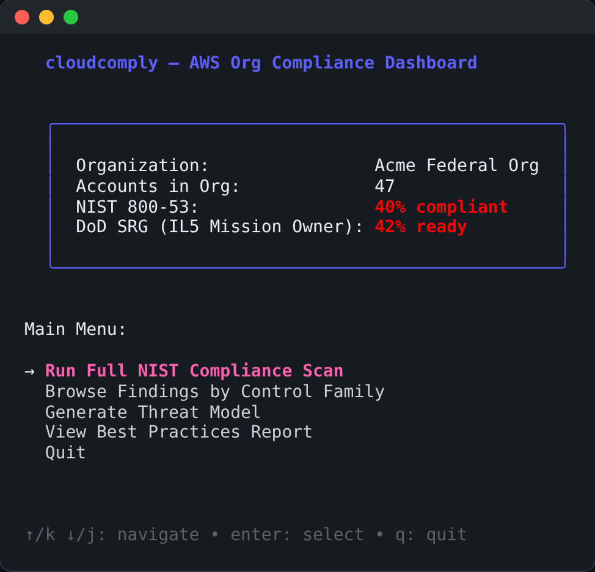
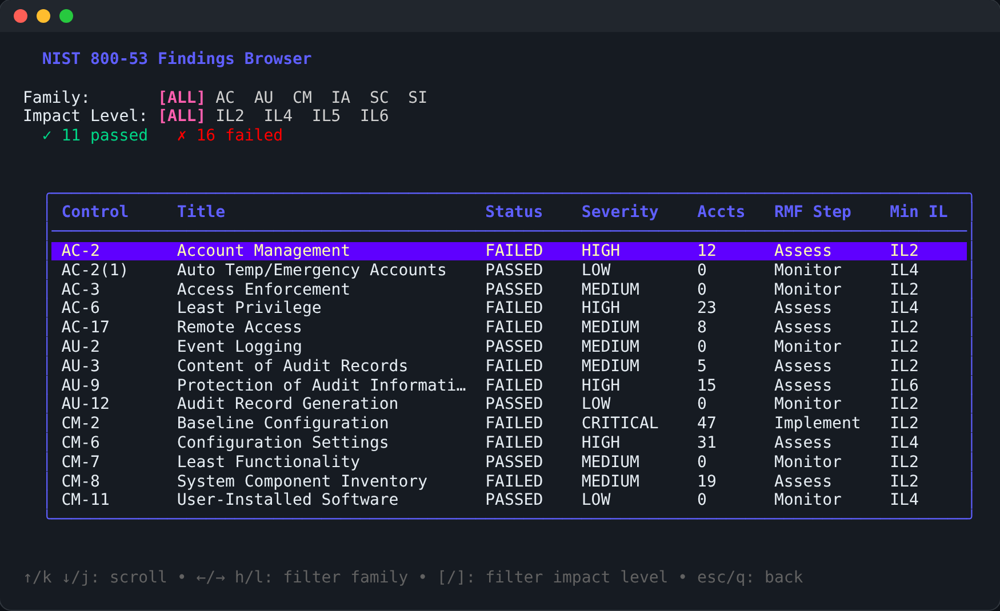

# cloudcomply

**Assess an AWS Organization against NIST SP 800-53 Rev. 5 from a single static binary.**

cloudcomply reads the NIST SP 800-53 findings that AWS Security Hub has already evaluated, groups them into one row per control, and gives you a compliance score. You can use it in two ways:

- an **interactive terminal dashboard** for exploring findings by control family and DoD Cloud Computing SRG Impact Level
- a **headless `report` command** that prints a table or JSON for scripts, CI pipelines and ATO evidence collection

```bash
cloudcomply --demo                     # offline sample data
cloudcomply                            # live dashboard
cloudcomply report nist --format json  # for automation
```

{ width="460" }
{ width="460" }

<div class="grid cards" markdown>

- **[Install](getting-started/installation.md)**: download a signed release, `go install`, or build from source.
- **[Quick start](getting-started/quickstart.md)**: run it in AWS CloudShell in under two minutes.
- **[Command reference](usage/cli.md)**: every command, flag and exit code.
- **[IAM permissions](aws/permissions.md)**: the minimal read-only policy.

</div>

## Who it's for

| You are… | cloudcomply helps you… |
|---|---|
| **Cloud security engineer** | See which NIST controls are failing across every account at once, without clicking through Security Hub's per-control console pages. |
| **GRC / ATO practitioner** | Score posture per control family and per DoD SRG Impact Level, and export JSON as assessment evidence. |
| **Platform / DevSecOps engineer** | Gate pipelines on failed controls with `report nist --format json` and `jq`. |
| **Developer evaluating the tool** | Try everything offline with `--demo`. No AWS account needed. |

## Design principles

- **Nothing to install:** one static Linux/macOS/Windows binary with no CGO and no runtime dependencies. Built to drop straight into AWS CloudShell.
- **Leaves nothing behind:** no agents, sidecars, daemons or config files, and no writes to your AWS account.
- **Read-only:** it calls only `Get*`, `List*` and `Describe*` APIs. See [IAM permissions](aws/permissions.md).
- **Keyboard-only:** every screen works without a mouse, so it's usable over SSH or in Termux on a phone.
- **No telemetry:** the only network calls are to AWS APIs, using your standard AWS credential chain.

## How it works

```text
 ┌───────────────────────┐     GetFindings (NIST 800-53 Rev. 5 standard,
 │  AWS Security Hub     │◄──── active records only, paginated)
 │  (delegated admin /   │
 │   aggregation region) │     DescribeOrganization / ListAccounts
 └──────────┬────────────┘◄──── (falls back to single-account mode)
            │
            ▼
 ┌───────────────────────┐
 │ aggregate per control │  one row per NIST control ID (e.g. AC-2):
 │ (internal/awsclient)  │  FAILED if any account fails it
 └──────────┬────────────┘
            │
     ┌──────┴───────┐
     ▼              ▼
  TUI dashboard   report nist --format table|json
```

cloudcomply does **not** run its own configuration checks yet. Its results are only as complete as the Security Hub NIST 800-53 standard in your account. See [How findings are scored](concepts/scoring.md).

!!! info "Project status"
    cloudcomply is early-stage (pre-1.0). The live Security Hub integration, the dashboard and the headless report work today. The DoD SRG Impact Level mapping is complete for demo data but is a placeholder (`IL2`) for live findings. See the [roadmap](project/roadmap.md).
